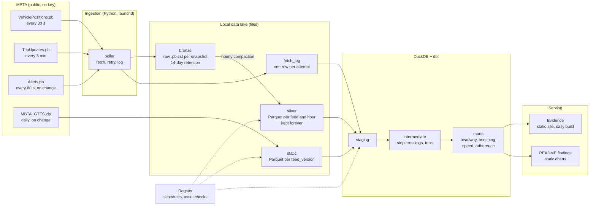

# Architecture

This project measures how reliably MBTA buses and trains run, using the
agency's public GTFS Realtime feed and its static GTFS schedule. It answers
questions a rider or a planner would ask: how long is the real gap between
buses on a route at 8 am, how often do buses arrive bunched together, how fast
is each segment, and how far from schedule does a trip run.

The design keeps three rules:

1. **Raw data is never lost and never changed.** Realtime feeds cannot be
   fetched again later, so every snapshot is archived exactly as received.
2. **Every later step can be re-run safely.** Each step reads the layer below
   it and overwrites its own output for a given hour or day, so a retry gives
   the same result.
3. **Nothing runs that the metrics do not need.** No queue, no streaming
   engine, no cluster. The volume (about 1.4 million position rows per weekday)
   fits comfortably on one machine.

## Data flow



## Components

| Component | What it does | Runs | Writes |
|---|---|---|---|
| `poller` | Fetches the three realtime feeds on their own cadence, retries with backoff, writes each snapshot atomically, logs every attempt. | Long-lived process kept alive by launchd. | `bronze/`, `fetch_log/` |
| `compact` | Parses one hour of bronze snapshots into one Parquet file per feed, dropping exact duplicates. Overwrites that hour. | launchd agent hourly at :10 (`--pending`) until Dagster takes over at phase 3. | `silver/` |
| `static` | Downloads `MBTA_GTFS.zip` when its ETag changes and stores each `feed_version` as Parquet. | launchd agent daily at 04:00 local time until Dagster takes over. | `static/` |
| dbt project | Staging, intermediate and mart models in DuckDB, plus tests. | Dagster, after each daily partition closes. | `warehouse.duckdb` |
| Dashboard | Evidence project that queries the aggregated DuckDB marts and builds a static site; query results are embedded in the build. | Daily static build, published on free hosting (GitHub Pages first choice). | Static site |

The poller is deliberately **outside** the orchestrator. A 30 second loop is a
service, not a batch job; scheduling it as 2,880 runs a day would make the
orchestrator the most fragile part of ingestion. The poller only writes files,
so it never competes with dbt for the DuckDB write lock.

## Storage layout

```
data/
  bronze/<feed>/date=YYYY-MM-DD/hour=HH/<header_ts>.pb.zst
  fetch_log/date=YYYY-MM-DD/<pid>-<start_ts>.jsonl
  silver/<feed>/date=YYYY-MM-DD/hour=HH.parquet
  static/feed_version=<sha256-12>/MBTA_GTFS.zip
  static/feed_version=<sha256-12>/<table>.parquet
  static/versions.parquet
  warehouse.duckdb
```

Dates and hours in paths are **UTC**, from the feed header timestamp, so a
snapshot always lands in exactly one place. Boston local time and the transit
service day are derived later in dbt.

## Where it runs

Phase 1 to 3 run on the owner's Mac. launchd starts the poller at login and
restarts it if it exits, with `caffeinate -i` preventing idle sleep while the
poller runs. Sleep is the main risk: while the Mac sleeps nothing is fetched,
and the gap shows up in `fetch_log` and in the data quality checks instead of
being hidden. Installation, scheduling, checking and wake behaviour are in
[the operations runbook](operations.md). Once the pipeline is stable it
moves to a small VM (see [ADR 0007](adr/0007-runtime-mac-then-vm.md)). Nothing
in the code depends on macOS; launchd is replaced by a systemd unit.

## Decisions

| ADR | Decision |
|---|---|
| [0001](adr/0001-protobuf-cdn-feeds.md) | Use the standard protobuf feeds from the MBTA CDN, not the V3 API or the enhanced JSON. |
| [0002](adr/0002-bronze-silver-files.md) | Archive raw snapshots as zstd protobuf, compact hourly to Parquet. |
| [0003](adr/0003-duckdb-warehouse.md) | DuckDB is the only warehouse. Postgres rejected; BigQuery dropped on 2026-11-25. |
| [0004](adr/0004-dagster-over-airflow.md) | Dagster over Airflow for orchestration. |
| [0005](adr/0005-headway-at-timepoints.md) | Measure headways where vehicles cross a fixed mid-route timepoint; nearest-rank percentiles. |
| [0006](adr/0006-evidence-dashboard.md) | Evidence static site on the DuckDB marts for the public dashboard; replaced Looker Studio on BigQuery on 2026-11-25. |
| [0007](adr/0007-runtime-mac-then-vm.md) | Run on the Mac with launchd first, a small VM later. |
